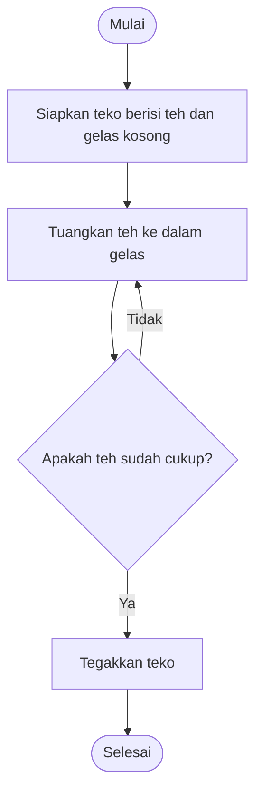

# **_menuangkan teh dari teko ke dalam gelas kosong_**

1. Mulai
2. Siapkan teko yang berisi teh dan satu gelas kosong
3. Pegang teko dengan hati-hati
4. Arahkan ujung teko ke bagian dalam teks
5. Miringkan teko secara perlahan agar teh mengalir ke dalam gelas
6. Perhatikan berapa jumlah teh yang masuk ke dalam kelas
7. Kalau teh sudah cukup, tegakkan kembali tekonya
8. Letakkan teko kembali ke tempatnya
9. Pastikan gelas sudah terisi teh sesuai keinginan
10. Selesai

## Cara menuangkan teh

